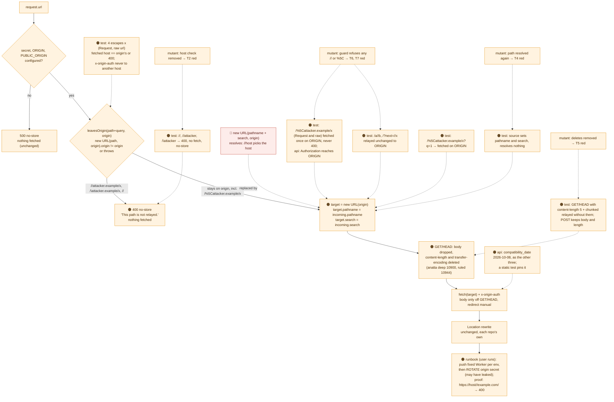

# 013 The Worker sets the request path on ORIGIN, never resolves it — no path picks the host the secret goes to

status: gated (merged locally, not pushed; the deploy runbook with the user, owner: the user and the orchestrator, due 2026-10-16) · rank: 8 · level: hard · type: bug · request: user, 2026-10-16 ("Oui, tâche urgente"), request thread docs/proxy-target discussion d51493764c4e14b · session: vizualisation-013-proxy-target · process: ../../docs/workflows/process-bug.mmd · after: [] · custody: the origin secret vizualisation-origin-secret-dev|prod: Secret Manager and the Worker secret ORIGIN_AUTH; the user rotates it (runbook), no agent reads or moves it

## Workflow


## Log
| Step | Result | Output |
| --- | --- | --- |
| Requirements | done | the user's go-ahead 2026-10-16 ("Oui, tâche urgente"), relayed by the main orchestrator; finding confirmed by a run in anatta (anatta-sso 066 review delta 1, message 10754, thread d3d985900787949 in workspace anatta-auth); fast path (no architecture change), the design copied from anatta-console 068 / anatta-sso 066 |
| Reproduce | done | through the Worker's entry point (`worker.fetch`, fetch stubbed), today's proxy.js: 27 tests, 24 pass, 3 fail — `"//attacker.example/x" sent x-origin-auth to https://attacker.example/x`; the 400 test got 200; the source test found the path resolved |
| Regression tests | done | infra/worker/proxy.test.mjs: the four steering tests (escapes x Request and raw url; 400 no fetch no-store; /%5C stays on ORIGIN; the source sets path and query) |
| Fix | done | commit e2cb838; infra/worker/proxy.js: `leavesOrigin` + `strayPath` (400 no-store) before the fetch; target = new URL(origin) with pathname and search set; 27/27 green |
| Mutants | done | M1 (path resolved again behind the guard): 1 fail, the source test; M2 (host check removed): 1 fail, the 400 test; file restored and compared |
| Fix 2 | done | from the orchestrator's relay of anatta's ruling (deep #10900, ruled #10944): when the body is dropped (GET/HEAD) the relayed headers drop content-length and transfer-encoding — anatta's lines exactly; tests first (anatta's two: GET/HEAD with content-length: 5 and transfer-encoding: chunked relayed without either; a POST keeps body and content-length); red on e2cb838: 29 tests, 28 pass, 1 fail; green 29/29; mutant M3 (deletes removed) 1 fail; M1, M2 re-run on the new head, 1 fail each; commit 85019a9 |
| Checks | done | node 29/29; cargo test ssr 324/0, csr 190/0, map crates 122/0; scripts 7/7 (infra_probe, check_workflows x2, port_strings, manifest-ref 10/0, serving-revision 12/0, origin-secret 38/0); tofu fmt/init/validate 0 (init retried on network resets) |
| Review round 1 | done | reviewer (Opus), entry vizualisation-013-proxy-target review d1379a612d61440 v2; voice deep #10964, #11001; rulings relayed by the main orchestrator |
| Fix round 1 | done | Δ1 task file committed; Δ2 the design carries fix 2 (LEN, T5, M3) and the round's tests, FETCH no longer 'unchanged'; T1 /%5Cattacker.example/x as Request and raw url fetched once on ORIGIN, never 400; T3 /a//b, /?next=//x, /a//b?next=//x&to=https://example.org//y relayed unchanged; T1/T3 pass on the current Worker (no behaviour change) and are nets: mutant M4 (a guard refusing any // or %5C) 3 fail; node 31/31; commit ab74726 |

## Summary
Rank: difficulty 2 (one function's target, a pattern already written and reviewed in anatta), impact 9 (a secret that opens the Cloud Run origin around Cloudflare's WAF and rate limits, on live public hosts) → 8 (security floor), hard: run by the orchestrating lead on Opus.

**The defect.** `new URL(incoming.pathname + incoming.search, origin)` RESOLVES the request path against ORIGIN. A path starting `//` — or `/\`, which the WHATWG URL parser reads as `//` for a special scheme — is a scheme-relative reference, so `https://<host>//attacker.example/x` became the target `https://attacker.example/x`, fetched with `x-origin-auth` (ORIGIN_AUTH) and every client header. Whether Cloudflare's edge merges `//` before the Worker is unknown; nothing relies on it. Hosts: map.dev.palicanon.app (password gate) and map.palicanon.app.

**The fix (decided, copied — not reinvented).** anatta-console 068's and anatta-sso 066's target code, line for line: a path that would leave ORIGIN's host when resolved, or names no host (`//`), is a 400 `no-store` ("This path is not relayed."), nothing fetched; otherwise the target is `new URL(origin)` with `pathname` and `search` SET. Everything else in the file is unchanged, the Location rewrite included. **Added by ruling (orchestrator relay, 2026-10-16; anatta deep #10900, ruled #10944):** when the body is dropped (GET, HEAD) the relayed headers drop `content-length` and `transfer-encoding` too, or the origin may wait for bytes that never come — anatta's lines exactly, its own commit.

**Ruled out.** Normalising the path (collapsing `//`): it changes what reaches the service for legitimate paths and is a second mechanism; relying on Cloudflare's edge normalisation: unverified.

**Deploy and rotation.** The user ruled (2026-10-16): merge the four branches, then deploy together step by step with the orchestrator; prod secrets rotated right after their Worker push, accepting the short refusal window — an exception to the repositories' rotation rule. Nothing is applied, pushed or deployed by an agent. The user runs the runbook: the fixed Worker pushed per env (`tofu apply` re-uploads the script; then `infra/scripts/origin-secret push <env>`, since an apply can drop the secret), then `vizualisation-origin-secret-<env>` rotated after the Worker is pushed (runbook); the proof is `https://<host>//example.com/` answering 400.

## Design
Viewer: vizualisation-013-proxy-target/design (d141d5ce0bcf946), validated 2026-10-16 by the user's go-ahead (fast path).


## Lanes
| File | Tests | Code | Done |
| --- | --- | --- | --- |
| infra/worker/proxy.js, infra/worker/proxy.test.mjs | the four steering tests | target set on ORIGIN, stray path 400 | lead, worktree ~/projects/palicanon/wt/vizualisation-013-proxy-target, branch fix/vizualisation-proxy-target |

## Runbook — the user runs it; no agent applies, pushes or deploys

One runbook for the four tasks (vizualisation 013, search-front 024, learn-pali 051, api 007). Actor: **the user**, on the Mac, every step. Nothing below has been run.

**Do not request `https://<host>//example.com/` before step 2 has run for that env**: on today's Worker that request makes the Worker send its origin secret to example.com — the very leak.

### 0. Once
```sh
gcloud auth application-default login
export CLOUDFLARE_API_TOKEN=$(security find-generic-password -a lsh -s cloudflare-api-token -w)
```
Apply from the **main checkout after the squash merge** (`~/projects/palicanon/<repo>/infra`): tofu uploads `file("worker/proxy.js")` from the directory it runs in, so an apply from an unmerged checkout ships the old Worker again. (If the merge must wait, apply from the task worktree `~/projects/palicanon/wt/<repo>-<NNN>-proxy-target/infra` — and no one applies from main until the merge.)

| service | infra dir | Worker per env | hosts (dev / prod) | origin secret (Secret Manager) | Cloud Run service | prod vars |
| --- | --- | --- | --- | --- | --- | --- |
| vizualisation | `vizualisation/infra` | `cloudflare_workers_script.proxy["dev"]`, `["prod"]` | map.dev.palicanon.app / map.palicanon.app | `vizualisation-origin-secret-<env>` | `vizualisation-<env>` | **`-var-file=prod.tfvars` required** (git-ignored; none in the main checkout today: recreate it from `prod.tfvars.example`). Dev and prod both need `cloudflare_account_id` (no default): `terraform.tfvars` from `terraform.tfvars.example`, none in the main checkout today |
| search-front | `search-front/infra` | same addresses | search.dev.palicanon.app / search.palicanon.app | `search-front-origin-secret-<env>` | `search-front-<env>` | **`-var-file=prod.tfvars` required** (present in the main checkout) |
| learn-pali | `learn-pali/infra` | same addresses | learn.dev.palicanon.app / learn.palicanon.app | `learn-pali-origin-secret-<env>` | `learn-pali-<env>` | none (prod is in the default `envs`) |
| api | `api/infra` | same addresses | api-dev.palicanon.app / api.palicanon.app | none (no origin secret yet) | `pali-canon-api-<env>` | none (both envs in the default) |

**Why `-var-file=prod.tfvars` matters**: vizualisation's and search-front's `envs` default holds dev only, so an untargeted apply without it plans to DESTROY the prod Worker and its domain. The targeted plans below touch one instance only; read each plan anyway.

### Per service, dev first, then prod (`<env>` = dev, then prod)

1. **Plan the Worker alone, and read it**
   ```sh
   cd ~/projects/palicanon/<repo>/infra && tofu init
   tofu plan -target='cloudflare_workers_script.proxy["<env>"]' [-var-file=prod.tfvars] -out=worker-<env>.plan
   ```
   Expect: `0 to add, 1 to change, 0 to destroy`, the one change being the script's `content` (api: also its new `compatibility_date`). Anything else (a destroy, a Cloud Run change) → stop.
2. **Push the fixed Worker, then its secret back at once**
   ```sh
   tofu apply worker-<env>.plan
   cd .. && infra/scripts/origin-secret push <env>     # NOT for api
   infra/scripts/origin-secret check <env>             # prints OK; NOT for api
   ```
   The re-upload can drop the Worker's `ORIGIN_AUTH` (the provider has no `keep_bindings`); until `push` the Worker answers 500 "The origin secret is not configured." — loud, and fixed by the push. api has no secret: step 2 is the apply alone.
3. **The read that proves the fix**
   ```sh
   curl -s --path-as-is -o /dev/null -w '%{http_code}\n' 'https://<host>//example.com/'    # → 400
   curl -s --path-as-is 'https://<host>//example.com/'                                     # → This path is not relayed.
   curl -s -o /dev/null -w '%{http_code}\n' 'https://<host>/'   # unchanged: 200 (map.dev 401: its password; api 401: its token)
   ```
   A 400 with that body is the Worker refusing. A 404 (or the service's page) instead means Cloudflare's edge merged `//` before the Worker — the probe is then inconclusive, not a failure (the node suite covers the Worker itself); `'https://<host>/%5Cexample.com/'` must reach the service (no 400).
4. **Rotate the origin secret** (vizualisation, search-front, learn-pali; not api) — it may already have leaked. Each repo's `infra/README.md` "Rotation", in order:
   ```sh
   openssl rand -hex 32 | gcloud secrets versions add <secret>-<env> --project palicanon-app --data-file=-   # value never printed
   infra/scripts/origin-secret push <env>                     # the Worker now sends the new value
   gcloud run services update <service>-<env> --project palicanon-app --region europe-west1 --revision-suffix rot-20261016   # a revision that reads it
   infra/scripts/origin-secret check <env>                    # OK
   ```
   (`origin-secret create` does nothing once a version exists, hence the explicit `versions add`.) Between the `push` and the new revision serving, the service answers the Worker 403 — a refusal window of seconds to a minute. The forced revision is "not yet exercised" per the READMEs: watch it become ready (`gcloud run services describe <service>-<env> --region europe-west1 --format 'value(status.latestReadyRevisionName)'`). Once OK, disable the previous version (`gcloud secrets versions list <secret>-<env>`, then `gcloud secrets versions disable <old> --secret <secret>-<env>`).
   Then re-read step 3 (still 400) and the site's normal page (200; or `scripts/rollout-check.sh --via-worker https://<host>`, with `--password-file` on map.dev).

**Prod rotation — the user's ruling, 2026-10-16 (relayed by the main orchestrator):** accept the short refusal window; rotate each prod origin secret right after its Worker push (step 4 with `prod`, immediately after steps 2–3). This is the user's recorded **exception** to the repositories' rotation rule (search-front and vizualisation `infra/README.md`, "Rotation": prod waits for a two-value rotation), taken because the secret may have leaked; the rule itself stands for any later rotation.

Optional read: if Workers Logs are on for these scripts, search for request paths starting `//` or `/\` since each Worker was deployed — a hit means the secret did leave.

Order across services: any, one at a time; each is independent (own state, own Worker, own secret). API tokens are not rotated: the api Worker held no origin secret, and its token-holding caller (search-front) only calls the fixed path `/v1/search`.

## Reviews
### Round 1 — 2026-10-16 — the reviewer read the branch at its first fix and task file; review entry vizualisation-013-proxy-target/review v2 (d1379a612d61440)
One reviewer (Opus) for the four branches; voice deep (#10964, #11001). Rulings by the main orchestrator:
- FIXED: Δ1 the task file committed; Δ2 the Design carries fix 2 and M3, FETCH no longer "unchanged"; T1 (all four) the encoded backslash fetched on ORIGIN as Request and raw url; T3 (all four) a later // relayed unchanged.
- FOLLOW-UPS (viewer): Δ4 learn-pali startsWith Location rewrite → folded into learn-pali-049 followup-worker-parity (da071c4176d4d4d), marked next after this deploy; Δ5 invalid ORIGIN crash and learn-pali http ORIGIN → followup-worker-origin-guard (df91caa317a164b, learn-pali session); Δ6 CI worker jobs unpinned → followup-worker-ci-reporter (d98257d48157748, vizualisation session); T4 length headers by method not body → followup-worker-length-by-body (d39d79ece25504f); T5 scheme-relative Location → followup-worker-scheme-relative-location (d4d08bc4b36cc44); T6 api suite breadth → followup-worker-suite-breadth (dc95f1815afcd4f, api session).
- ACCEPTED: Δ7 the source-reading test reads text, its regex widened (origin or env.ORIGIN).

## Merge
85fbf70 on main (local squash, 2026-10-16; not pushed — the push waits for the user, after the deploy order). Merge gate (each CI's commands runnable on this Mac): Homebrew rustc 1.98: fmt, leptosfmt, cargo test ssr 324/0, csr 190/0, map 122/0, rustdoc, CI scripts 7/7, node 31/31, tofu fmt/init/validate — exit 0; its clippy 1.98 refuses float_cmp in 26 test assertions of files this task does not touch, a local-toolchain difference: CI parity under the rustup stable 1.99 toolchain with wasm32 (the one palicanon sessions use), all six clippy matrix entries (wasm32 included), the three rustdoc entries, msrv 1.88 check x3 and cargo deny — exit 0. Not run: the browser tests (no chromedriver), the release bundle, coverage.
