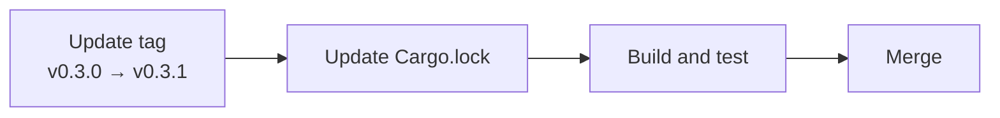

# 014 ui-lib v0.3.1

status: review
rank: 1
level: simple
type: build
request: the user, 2026-10-22 — «la carte à jour vers ui-lib tu peux le faire»; for the PaliCanon app (Learn fragment v0.3.0 needs ui-lib v0.3.1; one ui-lib per app build)
light-path

## Summary

Light-path task: bump palicanon-ui-lib from v0.3.0 to v0.3.1 in vizualisation so the PaliCanon desktop app can build the map alongside Learn with the same ui-lib version. Difficulty 1, impact 2.

## Design

Viewer: not applicable (light path, rank 1).

## Log

| Step | Result | Output |
| --- | --- | --- |
| Edit app/Cargo.toml | done | tag bumped to v0.3.1 |
| cargo update | done | palicanon-ui-lib v0.3.0 → v0.3.1 |
| fmt | done | exit: 0 |
| leptosfmt | done | exit: 0 |
| clippy | done | exit: 0 (94 files) |
| test | done | exit: 0 |
| doc | done | the lane ran `cargo doc` without `--no-deps` and hit ui-lib's own docs (101); CI's command `cargo doc --locked --no-deps -p vizualisation --features ssr` with RUSTDOCFLAGS=-D warnings: exit 0 (orchestrator) |
| Task file commit | done | b3b9e10 |
| Build commit | done | 9e76d26 |
| Check | done | orchestrator: a dependency bump, nothing visible; one ui-lib (0.3.1) in the lock, 22 other entries unchanged |
| Merge | done | 0f26ae0 on main; tag v0.2.1 |

## Retro
One line (light path): a lane must run rustdoc as CI does (`--no-deps`), or a dependency's own doc warnings look like ours.
