# 016 The footer badge says the deployed version, not the image's build ref

status: review (round 1 fixed, ready to merge) · rank: 3 · level: standard · type: fix · session: vizualisation-016-version-from-deploy · request: learn-pali 060 (the user, 2026-10-22: «apply le badge sur search / map / learn») · twin of learn-pali 060 (its design, validated and reviewed over three rounds, is the copy of record below; this task applies it to vizualisation)

## Summary
Rank: difficulty 3, impact 3 → 3. The same defect as learn-pali 060: the footer badge is baked into the content-addressed image, so a prod tag whose inputs equal main's shows `main · sha`. The same cure, already built, reviewed and merged in learn-pali (read its code as the model: `app/src/release.rs`, `app/src/app.rs` metas and `site_footer.rs`, `scripts/release-values.sh` + test, `scripts/rollout-check.sh` release gate, `.github/workflows/deploy.yml` step current/deploy/check, `infra/gcp.tf` ignore_changes, `infra/scripts/lifecycle.test.sh`, `app/tests/no_build_git.rs`, the READMEs): the env vars `VIZ_ENV` and `VIZ_SHA` on the Cloud Run revision (the map's Cloud Run service), written by the deploy with `--update-env-vars` only; the server reads them at start (absent → `dev`), writes two metas, the client reads the metas (missing → `unknown`); prod `v0.x.y` alone, main `main · sha7`, a branch dispatch `branch · sha7`; the skip compares image AND release; the gate asserts the metas before traffic moves (exit 8, never retried); tofu ignores the container env (applied before the first env write: the orchestrator runs the apply); the git capture, build.rs's part and the Dockerfile ARGs removed with a grep test; every new test file has its CI step. Adapt names to this repository (crate, env prefix `VIZ`, host map.palicanon.app); where this repository differs (its deploy workflow, its Worker, its tests), say so in the Log and keep the design's invariants. ui-lib 0.4.0's EnvBadge takes owned strings (an empty sha drops the separator).
Open: none for the design; the lead's plan may find repository specifics.

## Workflow

```mermaid
flowchart LR
  classDef todo fill:#eeeeee,stroke:#999999,color:#333333
  classDef doing fill:#fff3cf,stroke:#c98a00,color:#3a2a00
  classDef done fill:#e8f5e9,stroke:#2e7d32,color:#1b3a1d
  classDef skip fill:#ffffff,stroke:#999999,stroke-dasharray:4 3,color:#777777
  classDef fail fill:#fdecea,stroke:#c0392b,color:#5a1a12
  DEF["Define ✓ design = learn-pali 060 v4"]:::done
  PLAN["Plan ✓ lanes A B1 B2 C then D"]:::done
  BUILD["Build, wave 1 ✓ A B1 B2 C"]:::done
  BUILD2["Build, wave 2 ✓ D"]:::done
  VERIFY["Verify ✓ matrix exit 0, 28 lines"]:::done
  REV["Review ✓ round 1, F1-F3 fixed"]:::done
  CHECK["User check"]:::todo
  MERGE["Merge"]:::todo
  RETRO["Retro"]:::todo
  DEF --> PLAN --> BUILD --> BUILD2 --> VERIFY --> REV --> CHECK --> MERGE --> RETRO
```

## Log
| Step | Result | Output |
| --- | --- | --- |
| Define | done | the design is learn-pali 060's v4 (consensus and three review rounds there); the user's go 2026-10-22 |
| Plan | done | lead: a2m impact (`SiteFooter` reaches only `links`; `shell` reaches `language_attribute`/`theme_attribute`; `health` has no caller but the router: a2m is blind to the consts `BUILD_BRANCH`, `BUILD_SHA`, `BADGE` read through `env!` and to `view!` tags: found by grep, `app/src/app.rs:36-47`, `app/src/router.rs:35,41,282`, `app/src/components/site_footer.rs:21,46,267`, `app/build.rs`, `Dockerfile:86-89`, `deploy.yml:127-128`, `scripts/check_workflows.py:133`, `app/tests/image_context.rs:449-492`); open branches: `feat/data-tools` (a task file only), `fix/vizualisation-proxy-target` (`infra/worker/*`, `.task/013`): no overlap; base commit dacd8e4; lanes below; the model is learn-pali main 23c7ae2 (read only); base counts from `cargo test --locked -p vizualisation --features ssr` exit 0: lib 265, boot_process 6, image_context 15, image_hash_script 7, site_scripts 31; csr exit 0: lib 168; check_workflows_test 84 OK; origin-secret 38/0; serving-revision 12/0; manifest-ref 10/0 |
| Ruling | done | orchestrator, 2026-10-22: ASSUMPTION 4 accepted, `/health`'s first line is `ok <env>[ <sha>]` (`ok v0.1.8`, `ok main 34c489c`, `ok dev`); written in the repository specifics (item 1) and the design's `health` node |
| Build, wave 1 | done | A ede7dbf 87f7930 (release.rs, document metas, footer, hydrate reader, /health, release_document.rs wasm; reds 14 + 8, M1-M5), B1 f945d45 (gate: exit 2 usage, exit 8 release, secret masked; red 6/20, M1-M4c), B2 eefbd12 (release-values.sh + test 183 checks, deploy.yml, check_workflows 84 -> 101 tests; red 123 and 26, M1-M4), C 2b561b4 (gcp.tf env ignore, README, lifecycle.test.sh; M1-M3); integrated by cherry-pick as 87cbeb8 607a326 f833d6a f8e6730 5a4af19 |
| Fix, lead | done | d019042: lane C's README promised a branch dispatch (deploy.yml has none) and lacked the never `--set-env-vars` sentence: lifecycle.test.sh asserts both and that deploy.yml has no workflow_dispatch (red 2 FAIL first); 9d674a6: `template[0].revision` was NOT in `ignore_changes` (the old comment, copied from the API's infra, said the opposite; learn-pali and search-front ignore it): asserted (red 1 FAIL), added, README list updated |
| Build, wave 2 | done | D bc85d64 32959e1 839ea6c (build.rs without the git capture, git_info.rs deleted, Dockerfile ARGs gone, no_build_git.rs 4 tests, boot logs `release:`, /health first line pinned on the real binary, README); integrated as 6bd34da 46b3d06 ef87830; M1-M3 |
| Verify | done | tip 9d674a6, one run (verify.sh), exit lines: fmt 0; leptosfmt 0; clippy -D warnings app ssr all-targets 0, hydrate wasm32 0, csr wasm32 (+ tests csr, release_document) 0, csr host 0, map host 0, map wasm32 0; test ssr 0 (lib 272, boot_process 8, image_context 15, image_hash_script 7, no_build_git 4, site_scripts 38 incl. the two real-binary rollout tests and smoke_runs_the_binary_as_prod_does); test csr 0 (lib 170); test map 0; rustdoc -D warnings app ssr 0, map host 0, map wasm32 0; `cargo leptos build --release --cargo-locked` 0; check_workflows_test 101 OK exit 0; check_workflows 0; infra_probe_test 0; no_js_test 0; release-values.test.sh 183/0; manifest-ref 10/0; serving-revision 12/0; origin-secret 38/0; lifecycle 20/0; node --test worker 0; tofu fmt -check 0 and tofu validate 0 (scratch copy; `tofu init` fails here on a registry connection reset, so the providers came from the main checkout's .terraform with an identical lock file); workflows parse 0. Not run here: the two wasm browser tests (csr.rs, release_document.rs; no chromedriver): compiled and clippy-clean, they run in CI (test-browser). Rebase: origin/main is 2eec42e = the branch's base, no-op |
| Review round 1 | done | reviewer (Opus), review entry d79c96f58ee744a v1; voice deep #14503 (six items); ruled by the orchestrator #14506 (one round, rank 3): F1-F3 fixed by the lead, no second round |
| Fix round 1 | done | F1 3090f20 (release-values.sh refuses a ref name outside [A-Za-z0-9._/-], every mode, ref named; red: 134 failures on the old script; mutation `=` added to the class: red on the equals-sign case), F2 7ad5328 (infra/README: after a replace dev reads dev until the next push to main, a prod tag by a by-hand `gcloud run deploy <service> --region europe-west1 --update-env-vars VIZ_ENV=<tag>,VIZ_SHA=`; lifecycle.test.sh 2 FAIL first, now 21/0), F3 6a40939 (no stub-gcloud case existed: the real `current` step run against a stub gcloud, cases: empty document, unparsable, no image, env of the wrong type, another release, same release; green on arrival, pins the fail-open sentence; mutation running=true on the first branch: 3 FAIL). Check, not change (deep 6): the only user of `SiteFooter` is `Layout` in `app/src/app.rs:190` (`<AppShell nav=… footer=\|\| view! { <SiteFooter /> }>`), the site's own shell; the csr fragment (`app/src/fragment.rs`, `MapProvider` + `MapRoutes`) documents and holds no footer (`fragment.rs:23`: "What the fragment does not hold: the `AppShell` and its rail, the footer…"), so no `unknown` badge in the desktop app. Checks on 6a40939 (no Rust changed since the matrix): release-values.test.sh 337/0 exit 0; lifecycle 21/0 exit 0; check_workflows_test exit 0; check_workflows exit 0; serving-revision, manifest-ref, origin-secret, no_js, infra_probe exit 0; workflows parse exit 0 |
| Open for the merge | todo | (1) the orchestrator runs `tofu apply` in infra/ BEFORE the first deploy that writes VIZ_ENV (the env and the revision name join ignore_changes); (2) the first dev deploy: read the revision JSON (`gcloud run revisions describe ... --format json`, `.spec.containers[0].env`) for what Cloud Run stores for an empty `VIZ_SHA=` on a tag (`same` treats absent == empty, so the skip holds either way) and the dev badge `main · sha7`; (3) the first prod tag: badge `v0.x.y` alone. |

## Repository specifics (where this repository differs from learn-pali 060, the design's invariants kept)
1. `/health` said `ok <build sha>` (router.rs:41; `scripts/smoke.sh` and `scripts/rollout-check.sh` read `ok ` and a word): with the git capture gone its first line is `ok <env>` followed by ` <sha>` when there is one (`ok v0.1.8`, `ok main 34c489c`, `ok dev`). Still one line, still `ok ` and a word: the scripts read it unchanged, the router test expects the new line. Assumption, in the design as the `health` node.
2. `deploy.yml` has no `workflow_dispatch` (learn-pali 055 added it there): the deploy runs on a push to main and on a `v*` tag only. `scripts/release-values.sh` keeps the three cases of the model (tag, main, another branch) because it reads what Actions provides, and is tested on each; a branch release stays unreachable until a dispatch trigger lands (its own task, not this one). The infra README says a tag is restored by re-running the tag's deploy.
3. `deploy.yml` is one rollout step ("Roll out without traffic, check, then serve") not learn's numbered steps: the gate is the existing direct-mode call of `scripts/rollout-check.sh URL HEADER_FILE`; it gets `ROLLOUT_EXPECT_ENV` / `ROLLOUT_EXPECT_SHA` and its exit 8 gets its own `::error::`. A missing expectation is this script's usage error (exit 2; learn's script uses 64).
4. The workflow rules live in `scripts/check_workflows.py` (+ `_test.py`), which today demand `BUILD_BRANCH` / `BUILD_SHA` build-args (`check_build_args`): that rule becomes the opposite (no build-args) and the new wiring rules live there; the script tests of the rollout are `app/tests/site_scripts.rs` (Rust), not a `.test.sh`.
5. The CI step for the wasm browser test of the document reader (`app/tests/release_document.rs`) joins the `test-browser` job; no chromedriver on this laptop: that test is compiled and clippy-checked locally and runs in CI (the README line gives the command).

## Lanes
Wave 1 (parallel, disjoint files; `.github/workflows/ci.yml` is edited by three lanes at three distant places: A in the `test-browser` job, B2 after `check_workflows.py`, C after `origin-secret.test.sh`), wave 2 after A is integrated.

The contract the lanes share: env vars `VIZ_ENV` / `VIZ_SHA` on the revision; metas `viz-release-env` / `viz-release-sha` in the SSR head (the sha one always written, `content=""` for a tag); `scripts/release-values.sh` (prints `VIZ_ENV=<v>,VIZ_SHA=<v>`; modes `env`, `sha`, `same`); `scripts/rollout-check.sh` direct mode takes `ROLLOUT_EXPECT_ENV` (non-empty) and `ROLLOUT_EXPECT_SHA` (set, may be empty), exits 2 when one is missing, 8 on a meta mismatch (check name `release`); `/health` first line `ok <env>[ <sha>]`.

| Lane | Files | Tests (first) | Code | Model (all done) |
| --- | --- | --- | --- | --- |
| A Rust | `app/src/release.rs` (new), `app/src/app.rs`, `app/src/components/site_footer.rs`, `app/src/lib.rs`, `app/src/router.rs`, `app/tests/release_document.rs` (new, wasm), `.github/workflows/ci.yml` (one step in `test-browser`) | unit (`ReleaseInfo`: value, blank, absent, sha cut to 7, tag with no sha, from metas, health line); SSR render (metas in head, badge text per case, footer, no separator for a tag); `/health` line; the wasm reader | `ReleaseInfo`, `document`/`shell`, footer, `hydrate` wrapper, `/health` | Sonnet |
| B1 gate | `scripts/rollout-check.sh`, `app/tests/site_scripts.rs` | the meta mismatch (exit 8), the missing expectations (2), a healthy page with the right metas, the two other modes needing none | the `release` check in direct mode | Sonnet |
| B2 deploy | `scripts/release-values.sh` (new), `scripts/release-values.test.sh` (new), `.github/workflows/deploy.yml`, `scripts/check_workflows.py`, `scripts/check_workflows_test.py`, `.github/workflows/ci.yml` (one step in `scripts`) | literal-value test per event; `same` fixtures; wiring rules and their mutations | the script, deploy.yml (update-env-vars, no build-args, the skip compares the release, the gate gets the expectation) | Sonnet |
| C infra | `infra/gcp.tf`, `infra/README.md`, `infra/scripts/lifecycle.test.sh` (new), `.github/workflows/ci.yml` (one step in `scripts`) | grep test: `ignore_changes` holds the container env and the old entries; the README paragraph | `ignore_changes` + README paragraph; `tofu fmt`/`validate` in a scratch copy | Haiku |
| D cleanup (after A) | `app/build.rs`, `app/src/git_info.rs` (deleted), `Dockerfile`, `README.md`, `app/src/main.rs`, `app/tests/boot_process.rs`, `app/tests/image_context.rs`, `app/tests/no_build_git.rs` (new), `scripts/smoke.sh` (comment and message only) | grep test: no `VIZUALISATION_GIT`, no `git_info`, no `rev-parse` in the build files and sources; the boot prints `release:`; the Dockerfile has no `BUILD_BRANCH` / `BUILD_SHA` | removals; boot log line; README (Deploy: the badge, the apply order; the new test commands) | Sonnet |

Apply order (for the orchestrator and the user): `tofu apply` of lane C BEFORE the first deploy that writes `VIZ_ENV`, or the next apply strips the env and the badge reads `dev` with no diff shown.

## Reviews
### Round 1 (the only one, rank 3), 2026-10-22
Reviewer: review d79c96f58ee744a v1 (33 nodes, the design v1 beside); voice deep #14503 (deepseek-flash, six ranked items); ruling #14506. Findings, most severe first:
- F1 (deep 1, Δ1/T1) `release-values.sh` refused only a comma and whitespace; git allows `& < > " '` in a ref, the page escapes them in the meta attribute (`&amp;`), `rollout-check.sh` reads the raw attribute and exits 8 on a correct page. Taken in: refuse every character outside `[A-Za-z0-9._/-]`, in every mode, naming the ref (`feat/a&b`, `feat/a>b`, `feat/a"b`, `feat/a=b`, tag `v1&2` refused; `feat/a.b-c_d/e`, `v0.1.8-rc.1` accepted); 3090f20.
- F2 (deep 2, Δ2/T2) a replacement revision is built from HCL that holds no `VIZ_ENV`/`VIZ_SHA`; after `tofu apply -replace` the badge reads `dev`. Taken in: said in infra/README.md with the by-hand restore, asserted in lifecycle.test.sh; 7ad5328.
- F3 (deep 4, Δ4/T3) the two fail-open branches of the `current` step were pinned by nothing. Taken in: the real step run against a stub gcloud, one case per branch (running=false and the reason line); 6a40939.
- Checked, not changed (deep 6, Δ6): the desktop app mounts the csr fragment, which holds no footer (see Fix round 1).
- Ruled out: `--via-worker` checking the metas after the traffic moves (the gate checks the tagged URL before the move, by design); fail-open on an unreadable revision (060's design, logged); the graph's missing CI node (the reviewer's error, not the code's).

## Design
Viewer: vizualisation-016-version-from-deploy/design (d4e9190bf6a2d4d), v1 = learn-pali 060's v4 adapted to this repository (VIZ_ prefix, the `viz-release` metas, the repository specifics above); the user's go 2026-10-22.

```mermaid
flowchart TB
  today["today: the footer badge ('main · 34c489c', 'v0.1.7 · ebf34fa') is baked into the image at build time (const env! from build.rs: Dockerfile ARGs BUILD_BRANCH/BUILD_SHA passed by deploy.yml's build-args, else git); /health says 'ok <that sha>'; images are content-addressed (scripts/image-hash.sh: the tracked inputs, the Dockerfile and scripts/, the ui-lib commit), so a prod tag whose inputs equal main's reuses main's image and its badge says 'main' (seen 2026-10-17, v0.1.8)"]
  inv["invariant: what the badge says is a property of the DEPLOY REVISION (which ref was rolled out), not of the image; one value, written once by deploy.yml onto the revision, read by the server at start, handed to the browser through the SSR document. The image is identical across refs"]
  today --> inv
  subgraph WRITE["write: deploy.yml (the only writer; tofu never touches it)"]
    vals["two values mirroring the badge's two fields: VIZ_ENV = the tag name (v0.1.8) | main | the branch (a branch ref; this repository's deploy.yml has no workflow_dispatch yet, so only the script handles that case); VIZ_SHA = empty for a tag, sha7 otherwise. The workflow passes data, it parses nothing"]
    deploy["gcloud run deploy ... --update-env-vars VIZ_ENV=..,VIZ_SHA=.. (never --set-env-vars: it wipes RUST_LOG and the ORIGIN_SECRET reference, and every request would then be refused). The image build loses its badge build args: its hash no longer changes with the ref"]
    skip["'already running?' compares the SERVING revision's image AND its two env values to the intended ones; absent and empty compare equal (a jq default), so a tag release does not redeploy forever; any other difference deploys a new revision (same image, new env). So every push to main makes a revision and the dev badge shows the pushed sha; v0.1.9 with main's inputs still deploys"]
    tofu["infra/gcp.tf: ignore_changes gains the container env, like image and scaling today: a later tofu apply cannot rewrite the template and flip the badge. A RUST_LOG, VIZ_GATE or ORIGIN_SECRET edit after creation is a gcloud update or tofu apply -replace, written in infra/README.md. Order: this ignore is applied (tofu apply) BEFORE the first deploy that writes the env, or the next apply strips it and the badge reads 'dev' with no diff shown"]
    vals --> deploy --> skip
    tofu -.-> deploy
  end
  subgraph READ["read: the Rust side"]
    srv["server at start: ReleaseInfo { env, sha } from the two vars; absent or blank env → env 'dev', sha empty (local run; no git capture any more); sha is cut to 7 characters. build.rs capture_git_info, git_info.rs, the Dockerfile ARGs and the env! consts are deleted"]
    ssr["SSR document: ReleaseInfo written in <head> as <meta name='viz-release-env'> and <meta name='viz-release-sha'>, rendered into the footer badge from the same value"]
    cli["hydrate entry reads the two metas before mounting and provides the same ReleaseInfo to App: the client never recomputes, so SSR and hydration agree. The SSR always writes the metas and the rollout gate asserts them, so a missing one is a broken page: the client then shows 'unknown' (never 'dev', which is the local run's word, so a fault is not mistaken for a benign state)"]
    app["desktop app (client only, no server): its own version at build time (CARGO_PKG_VERSION / tauri.conf.json), same footer, same component; not the site's env; it mounts the Map fragment, which has no footer"]
    srv --> ssr --> cli
    app -.-> cli
  end
  badge["footer badge wording: prod tag 'v0.1.8' (no dot, no sha); dev 'main · 34c489c'; a branch ref 'feat/x · 34c489c'; local run 'dev'. ui-lib EnvBadge takes owned strings and an empty sha drops the separator and the sha (additive ui-lib change, released, then a tag bump here); EnvBadgeInfo and the shell's prop are untouched"]
  inv --> WRITE
  deploy --> srv
  cli --> badge
  gate["rollout gate: rollout-check.sh already curls the tagged revision's URL (direct mode, the origin header on); there it also asserts the document's viz-release metas equal the intended values (reads what a browser gets, not what the workflow computed); the intended values arrive as ROLLOUT_EXPECT_ENV and ROLLOUT_EXPECT_SHA (required in direct mode, the sha may be empty; --via-worker and --refused need none); a mismatch fails before the traffic moves, with a message and the exit code 8 of its own, never retried (a wrong release is not a flaky curl). A skip path deploys nothing and is not re-gated: the serving revision was gated when it shipped. Rollback to PREV restores PREV's own env: the badge follows the traffic"]
  deploy --> gate
  gate --> badge
  tests["tests: unit (ReleaseInfo from env: value, blank, absent, sha cut to 7, tag with no sha); SSR render (metas in head, badge text per case, the footer shows no dot for a tag); hydrate entry reads the metas (wasm-free helper over strings; a wasm browser test in the test-browser CI job); a script test in CI of scripts/release-values.sh, which reads the variables Actions provides (GITHUB_REF_TYPE, GITHUB_REF_NAME, GITHUB_SHA) and prints the two values; the test feeds it each event (push main, tag v0.1.8, dispatch of feat/x, a blank sha) and compares to LITERAL expected values (independent of the script, so it proves the rules); a wiring test greps deploy.yml: the deploy step calls the script and passes its output to --update-env-vars, no --set-env-vars anywhere, no VIZ_GIT build-args left (it proves the workflow calls it; the gate compares the served page to the same script, so it catches wiring and rollout faults but not a wrong script, which the literal-value test does); app/tests/site_scripts.rs gains the meta mismatch case; scripts/check_workflows.py swaps its BUILD_BRANCH/BUILD_SHA build-args rule for the new wiring rules (--update-env-vars from the script, no --set-env-vars, no build-args, the skip compares the release, the gate gets the expectation) with its tests; ui-lib EnvBadge tests (empty sha, owned strings)"]
  badge --> tests
  sf["search-front: the same defect, learn-pali 060 (merged) is the model, search-front has its own task"]
  inv -.-> sf
  health["/health (this repository only): its first line was 'ok <build sha>'; with the git capture gone it says 'ok <env>' followed by ' <sha>' when there is one (ok v0.1.8 | ok main 34c489c | ok dev): still one line, still 'ok ' and a word, so scripts/smoke.sh and rollout-check.sh read it unchanged"]
  srv -.-> health
```

| Apply | done | orchestrator, 2026-10-22: `tofu plan` with terraform.tfvars + prod.tfvars: no resource change; `tofu apply` complete |
| Check | done | the user's go for the badge on search/map/learn (2026-10-22); orchestrator: F1–F3 read; the dev metas read after the merge |
| Merge | done | b630d97 on main (squash), pushed: the dev deploy is the first env write; prod by tag v0.2.3 after the dev metas are read |
