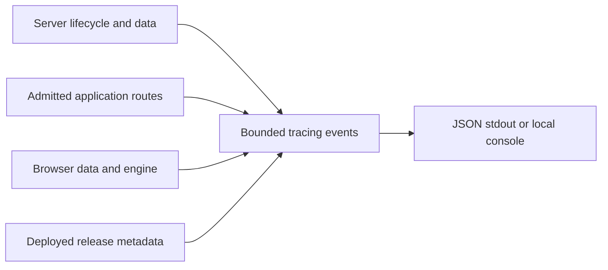

# 020 Structured operational logs for Map

status: merged locally | rank: 4 | level: standard | type: feature

## Request and scope

2026-11-13: the user corrected "visualization" to the sibling service
`../vizualisation`: instrument this service first, following Learn/API/Search.
Base: 85d6aa1. Worktree isolated from the user's modified Cargo.lock and task
015; ui-lib pinned to its committed v0.4.5, not the mutable sibling checkout.

Identity: service.namespace=palicanon, service.name=map, deployed VIZ_ENV tag/ref
as service.version, VIZ_SHA short commit, separate deployment environment and
server/browser runtime. JSON stdout SSR and JSON console hydration; no backend,
exporter, persistent browser ID or implicit CSR subscriber. CSR hosts may opt in.

Events: lifecycle, bounded boot/data failures, data ready, normalized routed
HTTP requests, sampled origin/password refusals, browser data fetch/parse
failures and engine startup/failures/warnings, payload-free panics. Never log
URLs, paths supplied by users, queries, visited text IDs, cookies, credentials,
raw parser/engine errors or data content. Whitelist file/backend categories.
Static files, health probes and unknown paths remain quiet. Preserve routes,
gates, cache policy, health response, map rendering and engine behavior.

## Checks

Actual process JSON, version propagation, request/privacy and refusal sampling;
JSON browser output and payload redaction; existing SSR, CSR native and browser
suites; SSR/hydrate/CSR clippy, map crate regression tests, docs and formatting.
The deployment hydration gate must also recognize runtime.panic. No WAF or
traffic-classification change; bot strategy remains a separate follow-up.

## Context

- GitSense currently lists no vizualisation index in PaliCanon or Anatta;
  exact local code and existing tests are used for this repository.
- Reuse the reviewed local Search logging adapter pattern. Its general shared
  contract extraction remains proposed in Learn task 079, not adopted here.
- This task prepares a local feature commit; no push, deployment or new public
  PR. External model review remains unavailable after the prior policy refusal;
  no private source is sent to another model.

## Result and validation

- Added the shared JSON shape with map identity and exact deploy tag/ref;
  browser identity comes from the server's release and deployment metas.
- HTTP logging is applied at each actual router boundary, not around the
  ServeDir fallback: a page emits exactly once with a normalized route; static
  files, unknown paths and default-level health probes remain quiet. Real-router
  integration tests verify query/cookie/text-ID redaction and absence of duplicates.
- Origin and password refusals have independent one-minute warning budgets.
  Asset names and engine backend labels are whitelisted; parser, URL, JsError
  and layout error text is discarded. CSR still leaves subscriber ownership
  to the host. Browser engine behavior/rendering is preserved.
- SIGTERM registration happens synchronously before loading data/binding the
  listener. The process test initially exposed the first-poll race and passed
  after the fix. The smoke test now uses a genuinely stubborn parent process:
  an inherited SIG_IGN alone no longer simulates refusal because Tokio replaces
  it. The test's real child is cleaned up even on assertion failure.
- Runtime panic detection was added to the rollout gate, with a JSON-panic case
  in its existing tests. New browser JSON test and its lint are registered in CI.
- Current final checks: SSR 352 passed / 2 ignored; CSR native 196 passed /
  2 ignored; map-engine/layout/formats 122 passed / 1 ignored; Chrome 8 passed
  (map mount/unmount, release document and console JSON). No failures remain.
- Clippy -D warnings: SSR all targets, hydrate wasm32 lib, CSR native all
  targets and CSR wasm32 lib/browser tests passed. Rustdoc -D warnings,
  rustfmt, leptosfmt, workflow policy, no_js (5 cases), shell syntax and diff
  checks passed. No MSRV, cargo-deny, release image, coverage or tofu apply
  was run as part of this scoped local feature qualification.
- Local diff review verified privacy fields, release ownership, feature gates,
  HTTP layer placement, gate responses and signal lifecycle. External independent
  model review was not attempted again; it remains unavailable under the prior
  export policy refusal. A local review is not an independent review.
- cargo sweep --time 7 completed; nothing old to delete. Disk remained above
  the 50 GiB cleanup threshold. Original checkout changes (task 015, Cargo.lock,
  dist/node_modules/tsbuildinfo) remain untouched. No merge, push or deployment.

## Authorized local merge

2026-11-13: user requested "merge alors" after the feature qualification.
Origin/main remained 85d6aa1. Squash integration uses the verified application
snapshot 7060848; only this task's closure metadata differs. No runtime or
configuration change was added during merge, so the recorded passing tests
and clippy/docs results still cover the committed application source.

Local closure review retains the independent-review limitation already stated
above. Shared conformance extraction (Learn 079), centralized collection,
dashboards and bot/noise strategy remain separate work. No new proposal is
accepted by this merge. Original checkout edits to Cargo.lock and task 015
were temporarily stashed and restored with their diff content verified; the
untracked build/frontend files were left in place. This is a local main merge,
without push or deployment.
